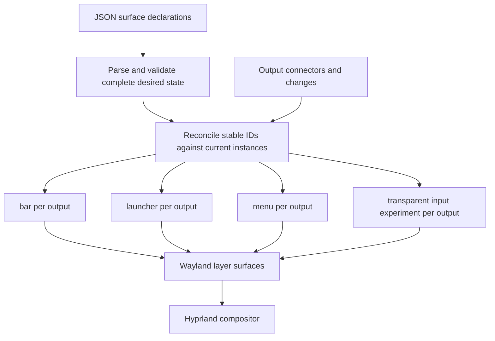
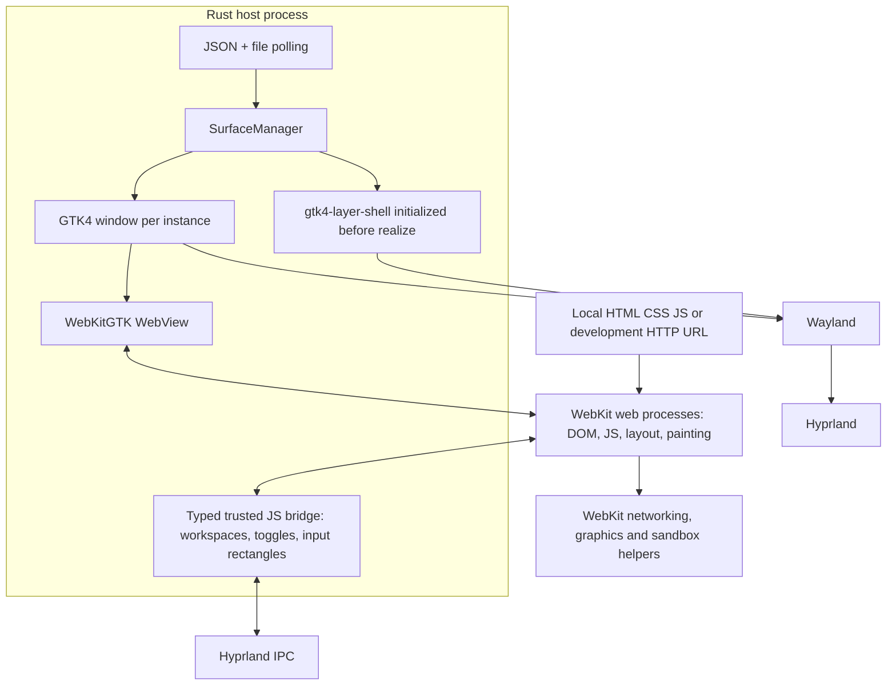
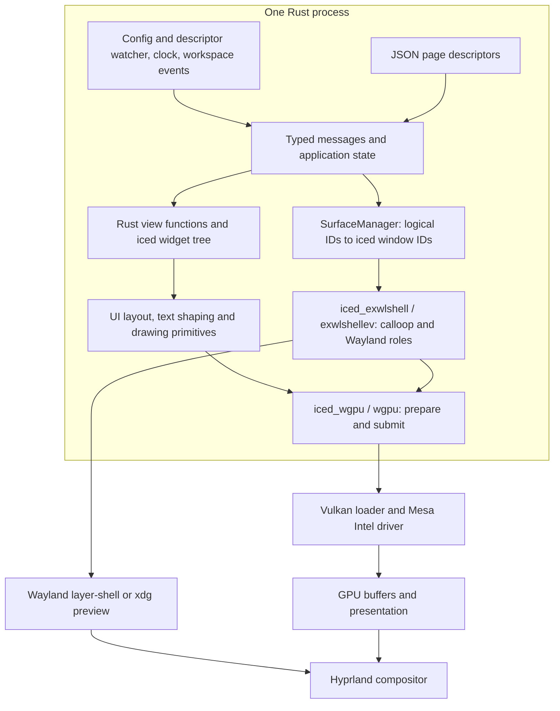
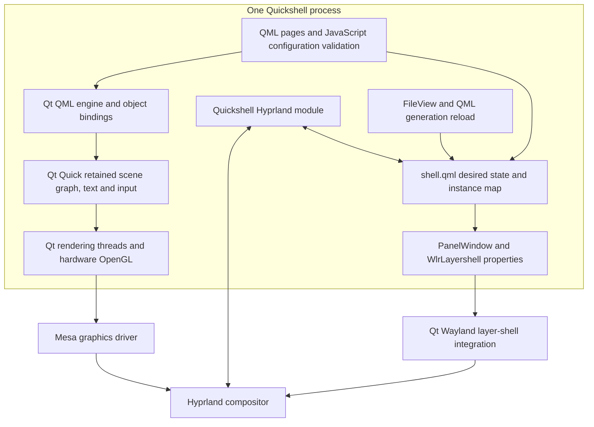
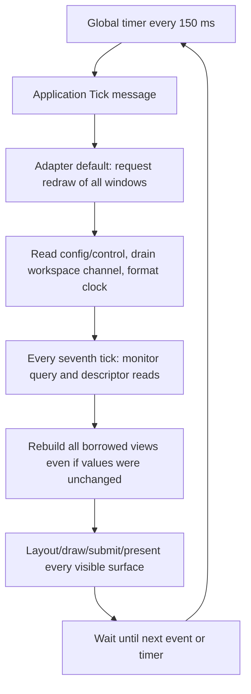
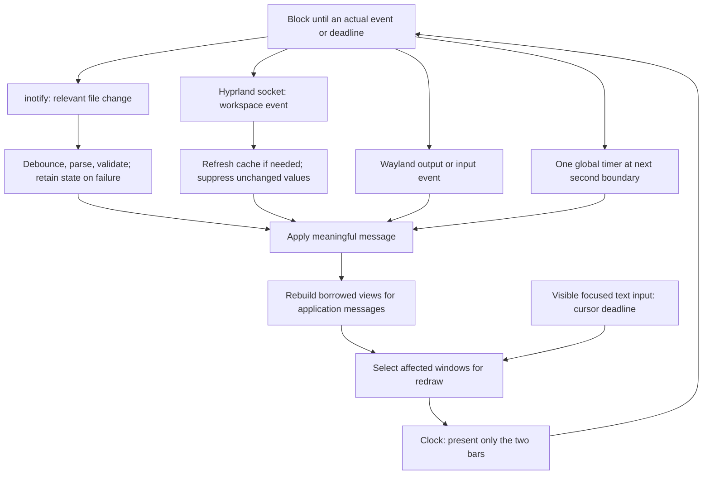

# Architecture and cost model

[Overview](README.md) · [Reproduce](REPRODUCING.md) · [Measurements](comparison/CPU_ANALYSIS.md)

The experiment asks how much runtime is needed to express a dynamically configured Wayland shell. Quickshell supplies an existing declarative shell environment; the Rust prototypes implement a small portion of that environment themselves. “Native Rust” here still includes a UI toolkit, text stack, GPU abstraction, async executor, and Wayland adapter.

## Shared surface model

A declaration such as `bar` with `output: "*"` expands into instances such as `bar@eDP-1` and `bar@DP-3`. IDs survive native object replacement. Invalid configurations retain the working layout. Each implementation owns its own reconciliation code; the shared contract is a behavior specification, not a shared library.

Popups use separate native surfaces because content cannot paint outside its parent surface. Input masks let transparent areas pass pointer events to applications underneath. Hyprland IPC supplies workspace state and activation; generic Wayland output events do not expose workspace state.

## WebKit / GTK

The host uses direct Rust C FFI, not Tauri or gtk-rs. GTK owns native widgets; the surface manager retains the window/WebView state. All eight WebViews are created eagerly, including hidden overlays. Browser content has DOM/layout/JS state and additional processes; the measured tree contained about 50 processes including helpers. Web-process termination is detected and the affected view is recovered without intentionally killing the host.

Local asset reload and HTTP HMR do not recreate the GTK surface. Privileged messages are restricted to trusted project content and permitted loopback origins. Remote pages do not automatically receive shell privileges. This is a narrow bridge, not arbitrary command execution.

## iced / wgpu

The executable contains compiled Rust UI/rendering dependencies; system graphics and Wayland libraries remain dynamic. There is no browser or QML engine. Hidden overlays are destroyed, so their native windows cannot render. One global clock and workspace source serve all outputs. Descriptors can change titles/themes/page kinds at runtime; arbitrary widget changes require compilation.

Two vendored adapter crates carry boundary counters and a small multi-window redraw-scope extension. See [vendor provenance](iced-shell/vendor/README.md). This is a custom integration, not a claim about an unmodified default iced application.

## Quickshell / Qt Quick

QML source is small because Quickshell and Qt provide the native surface objects, bindings, input, scene graph, and reload environment. Those capabilities live in the executable and dynamic Qt libraries/plugins. QML reload reconstructs dynamic surfaces in the same host; JSON property reconciliation retains their objects. QML is trusted shell code, not browser-sandboxed content. A native crash can terminate the host, as with iced.

## What “size” means

| Measurement | What it includes | What it does not establish |
| --- | --- | --- |
| Executable bytes | Compiled code/data; potentially symbols and static dependencies | Total installed dependencies or runtime memory |
| Nix closure | Recursive store dependencies rooted at selected paths | Bytes resident in RAM or exact portable deployment size |
| RSS | Resident mappings summed across processes | Unique physical memory; shared pages can be counted repeatedly |
| PSS | Resident pages proportionally apportioned among sharing processes | Complete GPU/driver allocation or a per-component causal breakdown |

For orientation, the local measured release files are 12,476,416 bytes for iced and 1,050,088 bytes for the WebKit host. This does **not** mean the browser stack is smaller: most of it is in dynamic libraries and child processes. Quickshell's launcher/wrapper alone is likewise not its runtime size. These are file sizes of this build, not a controlled stripped-binary comparison.

The historical mapped-library-root Nix closure estimates were approximately 1,112 MiB iced, 2,148 MiB Quickshell, and 3,496 MiB WebKit. They include transitive native dependencies such as fonts, drivers, plugins and media support, and are neither minimal deployment closures nor current dependency audits. See the [original inventory and caveats](comparison/REPORT.md). Cargo dependency counts alone miss Qt and WebKit's native stacks.

The fresh release-validation idle PSS is about 42 MiB iced, 94 MiB Quickshell, and 441 MiB WebKit. Architecture explains plausible sources of these costs, but we did not attribute every resident page to a subsystem. Eager hidden WebViews, destroyed iced overlays, different text engines and graphics backends are real comparison differences. Bringing in Qt buys functionality and development infrastructure; its cost cannot be judged from the size of the panel's QML file alone.

## iced before: a tick invalidates every visible surface

The event loop itself already blocked between events. The problem was manufacturing frequent application messages combined with global invalidation. Equality checks inside the update function came too late to prevent redraw. With two bars this produced about 13.3 presents/second; with all eight surfaces visible, about 53.4. CPU was 2.06% idle and 5.31% active in the reproduced baseline.

## iced after: events and scoped invalidation

The static workload has no clock, watchers, workspaces, or changing state: it renders initially and then blocks, with no recurring UI dispatches or frames observed. Normal clocks produce two bar presents/second and about 0.33% CPU. All eight views still rebuild on an application message when all surfaces are visible, but unchanged overlays are not presented. A focused launcher caret can independently request redraws; “no application messages” does not always mean “no animation.”

This validates event-driven scheduling and scoped redraw for this prototype. It does not prove that Qt Quick's retained scene graph is intrinsically more or less efficient. The next useful experiment is equivalent event-driven inputs in all three implementations before attempting a custom retained Rust renderer.
